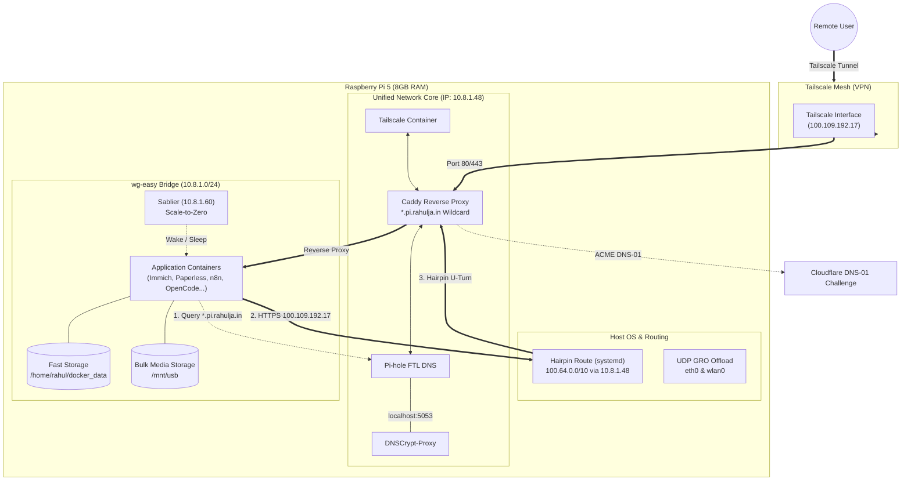

# Raspberry Pi Home Lab (Docker)

Production-grade containerized home lab running on a Raspberry Pi 5 (8GB) with Debian Trixie. Manages 54 self-hosted services via Docker Compose with strict security hardening, zero-trust container permissions, scale-to-zero resource management, and unified Tailscale VPN access.

---

## 🚀 Overview

The stack is designed for high reliability, minimal idle power/memory consumption, and complete isolation:
- **Unified Network Gateway (`10.8.1.48`):** Tailscale, Caddy reverse proxy, Pi-hole DNS sinkhole, and DNSCrypt-Proxy share a single network namespace.
- **Persistent Hairpin Routing:** Local container-to-container and host-to-container HTTPS communication resolves via Tailscale CGNAT without gateway dropouts.
- **Single Wildcard SSL:** Caddy automatically provisions and renews a single `*.pi.rahulja.in` certificate via Cloudflare DNS-01 ACME challenges.
- **Scale-to-Zero (Sablier):** Non-essential services sleep when idle and wake on HTTPS request.
- **100% Resource Hardening:** Explicit memory ceilings (`mem_limit`) and Docker healthchecks across all 54 services protect the 8GB host against kernel OOM lockups.

---

## 📐 Network & Hairpin Architecture

### Unified Network Core & Hairpin Route

All subdomains (`*.pi.rahulja.in`) map to the Pi's Tailscale IP (`100.109.192.17`) in Pi-hole. Because Tailscale runs **inside a Docker container** rather than directly on the host OS, outbound container traffic to `100.x` would default to the host's physical ISP gateway (`192.168.1.1`) and drop. 

To solve this, the persistent host systemd unit `/etc/systemd/system/rpi-tailscale-hairpin.service` sets:
```bash
/sbin/ip route replace 100.64.0.0/10 via 10.8.1.48
```
This forces the host kernel to perform a **hairpin turn** (U-turn) back into container `10.8.1.48` (Caddy/Tailscale), enabling local containers and host processes to access all services using canonical HTTPS domains.



---

## 🔒 Reverse Proxy & Security Hardening

### Wildcard SSL & ACME DNS-01
Caddy issues a single wildcard certificate (`CN=*.pi.rahulja.in`) via Cloudflare DNS challenge, shared by all subdomains. This eliminates Let's Encrypt rate limits and certificate sprawl.

### Security Headers Snippet
Every active service route imports the `(security_headers)` snippet:
```caddyfile
(security_headers) {
	header {
		Strict-Transport-Security "max-age=31536000; includeSubDomains"
		X-Content-Type-Options "nosniff"
		X-Frame-Options "SAMEORIGIN"
		Referrer-Policy "strict-origin-when-cross-origin"
		-Server
	}
}
```
- **HSTS:** Enforces HTTPS for 1 full year; prevents SSL-stripping MITM attacks.
- **X-Content-Type-Options:** Prevents browser MIME-type sniffing (drive-by script injection).
- **X-Frame-Options:** Blocks clickjacking in hidden external `<iframe\>` contexts.
- **Referrer-Policy:** Suppresses private application query paths in outbound referrers.
- **-Server:** Removes the `Server: Caddy` response banner to deter automated scanner fingerprinting.

### Decommissioned Route Sink (HTTP 410)
Historical services not currently running return instant `HTTP/2 410 Gone` rather than hanging on dead proxy sockets:
```caddyfile
wg.pi.rahulja.in {
	respond "Service decommissioned" 410
}
```

---

## 💾 Memory Budget & Resource Hardening (8GB RAM)

### Overcommit & Sizing Strategy
Running 54 containers simultaneously on an 8GB board would exhaust physical RAM. The homelab uses a dual-layer strategy:
1. **Scale-to-Zero:** 46 application stacks sleep via Sablier when idle.
2. **Strict Cgroup Ceilings:** 100% of services define an explicit `mem_limit`. If a rogue container leaks or spikes (e.g. Immich ML or Paperless OCR), only that container is throttled or restarted by its cgroup—preventing host kernel OOM panics.

### Memory Allocation Matrix

| Tier | Services | Limit Each | Rationale |
| :--- | :--- | :---: | :--- |
| **Micro Proxies & Daemons** | `dnscrypt-proxy`, `sablier`, `socket-proxy-read`, `socket-proxy-admin`, `firefly-cron`, `miniflux-cron` | **64M** | Ultra-lean compiled Go/C/Alpine daemons. Idle footprint 5-20MB. |
| **In-Memory Caches & Brokers** | `immich-redis`, `ghostfolio-valkey`, `sure-redis`, `paperless-redis`, `firefly-redis`, `gramps-redis` | **128M** | Valkey key-value stores for queues and session state. Homelab datasets <20MB. |
| **Light Web Utilities** | `miniflux`, `ntfy`, `cyberchef`, `portainer` | **128M** | Lightweight Go binaries and static asset webservers. |
| **Single-User Relational DBs** | `ghostfolio-db`, `miniflux_db`, `resume-db`, `sure-db`, `paperless-db` | **256M** | PostgreSQL instances. Buffer cache fits comfortably within 256MB. |
| **Core Network & Proxies** | `tailscale`, `caddy` | **256M** | High-throughput Go networking. Accommodates TLS handshake surges. |
| **Lightweight Web Apps** | `filebrowser`, `memos`, `actual`, `ezbookkeeping`, `burnrate`, `firefly-importer`, `n8n-runners`, `resume` | **256M** | Single-user Go, SQLite, light Node, and Python apps. |
| **Worker Subprocesses** | `sure-worker` | **384M** | Ruby Sidekiq background execution engine. |
| **Medium Applications & DBs** | `pihole`, `homepage`, `firefly`, `ghostfolio`, `immich-database`, `stirling-pdf`, `drawio`, `grampsweb`, `grampsweb_celery`, `paperless-tika`, `paperless-gotenberg`, `sure` | **512M** | Heavy Node.js, Spring Boot Java JVM, Apache Tika, headless Chromium, and vector database workloads. |
| **Automation Engine** | `n8n` | **768M** | Node.js automation engine handling complex workflows and large JSON trees. |
| **Heavy Archive Crawler** | `archivebox` | **768M** | Python/Django + Chromium headless web crawler. |
| **Full Heavy Applications** | `paperless-ngx`, `jellyfin`, `immich-machine-learning`, `opencode`, `antigravity` | **1024M** | OCR/document parsing, .NET media server, CLIP/ONNX CPU inference, and VS Code/TTY agent runtimes. |
| **Heavy Media Engine** | `immich-server` | **1536M** | NestJS/sharp/libvips image transformation and batch upload pipelines. |
| **Virtual Browser** | `firefox` | **4096M** | Full GUI browser (Neko/Kasmweb). Kept scale-to-zero when not in active use. |

**Baseline Footprint:** Core stack (`tailscale`, `pihole`, `caddy`, `homepage`, `dnscrypt-proxy`, `sablier`, `socket-proxy-read`) + Debian host OS consumes **~2.7 GB RAM**, leaving **~5.3 GB dynamic headroom** for Sablier-managed services.

---

## 🛠️ Services & IP Allocations

All containers communicate over the `wg-easy` bridge (`10.8.1.0/24`) using Pi-hole (`10.8.1.48`) as their primary resolver.

| Service | Internal IP | External URL | Mode / Profile | Role |
| :--- | :--- | :--- | :---: | :--- |
| **Tailscale / Caddy** | `10.8.1.48` | `*.pi.rahulja.in` | Core | VPN Gateway & Wildcard Reverse Proxy |
| **Pi-hole** | `10.8.1.48` | `pihole.pi.rahulja.in` | Core | Local DNS Sinkhole & Ad Blocker |
| **DNSCrypt-Proxy** | `10.8.1.48` | `dnscrypt.pi.rahulja.in` | Core | Encrypted Upstream DNS Proxy |
| **Homepage** | `10.8.1.57` | `dash.pi.rahulja.in` | Core | System Dashboard |
| **Sablier** | `10.8.1.60` | Internal API | Core | Scale-to-Zero Middleware Coordinator |
| **Socket Proxy (Read)** | Internal | `tcp://socket-proxy-read:2375` | Core | Read-only Docker Socket Gateway |
| **Socket Proxy (Admin)**| Internal | `tcp://socket-proxy-admin:2375` | Lazy | Admin Docker Socket Gateway (Portainer) |
| **Immich Server** | `10.8.1.6` | `immich.pi.rahulja.in` | Sablier | Photo & Video Backup Server |
| **Paperless-ngx** | `10.8.1.32` | `pngx.pi.rahulja.in` | Sablier | Document Management & OCR |
| **Transmission** | `10.8.1.23` | `trans.pi.rahulja.in` | Sablier | BitTorrent Client (12h idle timeout) |
| **OpenCode** | `10.8.1.70` | `opencode.pi.rahulja.in`| Sablier | AI Web IDE & VS Code Server |
| **Antigravity CLI** | `10.8.1.71` | `agy.pi.rahulja.in` | Sablier | Agent Terminal Web Interface |
| **Filebrowser** | `10.8.1.34` | `filebrowser.pi.rahulja.in`| Sablier | Web File Manager |
| **N8n** | `10.8.1.53` | `n8n.pi.rahulja.in` | Sablier | Workflow Automation Engine |
| **Firefly III** | `10.8.1.43` | `firefly.pi.rahulja.in` | Sablier | Personal Finance Management |
| **Ghostfolio** | `10.8.1.4` | `ghostfolio.pi.rahulja.in`| Sablier | Net Worth & Portfolio Tracker |
| **Actual Budget** | `10.8.1.3` | `actual.pi.rahulja.in` | Sablier | Zero-based Budgeting App |
| **ezBookkeeping** | `10.8.1.19` | `ezbookkeeping.pi.rahulja.in`| Sablier | Double-entry Accounting |
| **Stirling-PDF** | `10.8.1.58` | `pdf.pi.rahulja.in` | Sablier | PDF Utilities |
| **Memos** | `10.8.1.41` | `memos.pi.rahulja.in` | Sablier | Privacy-first Notes |
| **Miniflux** | `10.8.1.28` | `miniflux.pi.rahulja.in` | Sablier | RSS Reader |
| **ArchiveBox** | `10.8.1.17` | `archivebox.pi.rahulja.in`| Sablier | Self-hosted Web Archiver |
| **Ntfy** | `10.8.1.26` | `ntfy.pi.rahulja.in` | Sablier | Push Notifications Server |
| **Reactive Resume** | `10.8.1.39` | `resume.pi.rahulja.in` | Sablier | Resume Builder |
| **CyberChef** | `10.8.1.36` | `cyberchef.pi.rahulja.in`| Sablier | Web Swiss Army Knife |
| **Gramps Web** | `10.8.1.61` | `gramps.pi.rahulja.in` | Sablier | Collaborative Genealogy Tree |
| **Burnrate** | `10.8.1.69` | `burnrate.pi.rahulja.in` | Sablier | Bank Statement Analyzer |
| **Firefox** | `10.8.1.22` | `firefox.pi.rahulja.in` | Sablier | Virtual Web Browser (Neko) |
| **Draw.io** | `10.8.1.24` | `drawio.pi.rahulja.in` | Sablier | Architecture Diagramming |
| **Portainer** | `10.8.1.59` | `portainer.pi.rahulja.in`| Sablier | Container Management Web UI |
| **Jellyfin** | Host Mode | `jellyfin.pi.rahulja.in` | Sablier | Media Server (Host Mode for DLNA) |

*Full IP allocations and auxiliary backend IPs (Postgres, Valkey, Celery, Tika, Gotenberg) are tracked in `docker-compose.yml`.*

---

## ⚙️ Host Requirements & Setup

### 1. Systemd Persistent Hairpin Route
Create `/etc/systemd/system/rpi-tailscale-hairpin.service`:
```ini
[Unit]
Description=Route Tailscale CGNAT subnet (100.64.0.0/10) to Tailscale container
After=network-online.target docker.service
Wants=network-online.target

[Service]
Type=oneshot
RemainAfterExit=yes
ExecStart=/sbin/ip route replace 100.64.0.0/10 via 10.8.1.48
ExecStop=/sbin/ip route del 100.64.0.0/10 via 10.8.1.48 || true

[Install]
WantedBy=multi-user.target
```
Enable and start the service:
```bash
sudo systemctl daemon-reload
sudo systemctl enable --now rpi-tailscale-hairpin.service
```

### 2. Environment Setup
```bash
cp example.env .env
cp example_pihole.env pihole.env
# Configure CLOUDFLARE_API_TOKEN, TAILSCALE_AUTH_KEY, and paths in .env
```

### 3. Deploy Stack
```bash
# Start core infrastructure
docker compose up -d

# Start specific lazy services on demand (or let Sablier trigger them)
docker compose --profile lazy up -d <service-name>
```

---

## ✅ Stack Validation & Auditing

Run automated hygiene checks before committing changes:
```bash
# 1. Validate Compose syntax
docker compose config --quiet

# 2. Run comprehensive hygiene audit (IP clashes, mem_limits, healthchecks, Caddy routes)
./scripts/audit-config.sh

# 3. Validate Caddyfile within container
docker exec caddy caddy validate --config /etc/caddy/Caddyfile

# 4. Check container health status
docker ps --format "table {{.Names}}\t{{.Status}}"
```
