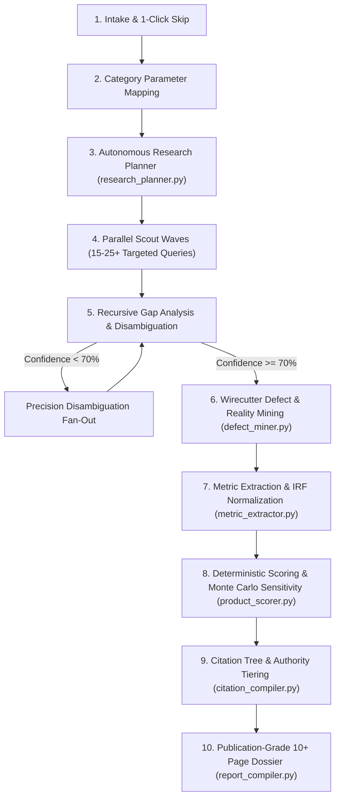

# Product Research Skill

A systematic, deterministic consumer buying advisory and autonomous deep research engine for OpenCode.

Inspired by **Gemini Deep Research** and **Stanford STORM**, this skill combines autonomous multi-phase query fan-outs, RTINGS-style objective lab benchmarks, Wirecutter-style long-term defect mining, recursive gap-analysis heuristics, and mathematically verified scoring.

---

## Rationalization Table: Why Strict Discipline is Mandatory

| Shortcut / Temptation | Why It Fails in Consumer Research | Production-Grade Standard |
| :--- | :--- | :--- |
| **Shallow One-Shot Web Search** | Single generic queries yield sponsored SEO blogs, affiliate listicles, and superficial spec recycling. | **Autonomous 4-Phase Query Fan-Out:** Execute `scripts/research_planner.py` to generate 15–25+ targeted queries with exact operators (`site:reddit.com`, `inurl:review`, `filetype:pdf`). |
| **Manufacturer Spec Sheets** | Brands publish peak misleading figures (e.g. 4,500-nit marketing peaks dropping to 400 nits under sustained heat). | **RTINGS-Style Objective Lab Benchmarks:** Harvest measured panel lux, color Delta-E, sustained thermal throttling (3DMark/Cinebench loops), and dB acoustic metrics. |
| **E-Commerce Star Ratings** (e.g., Amazon 4.3★) | Retail star ratings are heavily astroturfed by sponsored reviews, free-product incentives, and day-1 unboxing euphoria. | **Wirecutter-Style Teardown & Defect Mining:** Search authentic enthusiast communities (`site:reddit.com`, technician teardown channels) for 6–12 month failure patterns. |
| **Manual Unstructured Evidence Guessing** | Extracting lab numbers and defect severities manually from raw web results leads to cherry-picked, hallucinated, or uncorroborated ratings. | **Wirecutter Defect & Evidence Miner (`defect_miner.py`):** Automatically parse raw search text and Reddit threads into structured JSON with defect taxonomy (`critical`/`severe`/`moderate`/`minor`), corroboration tagging (`systemic` vs `batch` vs `lemon`), and numeric lab extraction. |
| **Assumed Data Completeness** | LLMs silently hallucinate missing technical metrics or skip key criteria when evidence is absent. | **Recursive Gap-Analysis Engine:** Check findings against required dimensions with a strict confidence threshold (≥70%); generate targeted disambiguation queries for gaps. |
| **Intuitive / Uncalibrated Scoring** | Models hallucinate subjective, inconsistent decimal scores directly from text findings. | **Deterministic Metric Normalization:** Execute `scripts/metric_extractor.py` to map raw lab measurements through RTINGS-grade curves, apply defect penalties/ceilings, and compute exact IRF. |
| **LLM Mental Math** | Models hallucinate subjective averages where weights fail to sum to 1.0 or miscalculate VFM. | **Deterministic Scoring:** Execute `scripts/product_scorer.py` via Python to calculate normalized weights, IRF multiplier, and VFM index mathematically. |
| **Fragile Winner & Blind Ranking** | Small subjective weight changes or marketing fluff flip picks; users cannot distinguish a 95% solid winner from a 51% fragile coin-flip. | **Data Confidence & Monte Carlo Sensitivity Engine (`product_scorer.py`):** Penalize unverified/imputed data to protect lab-tested contenders. Run Monte Carlo weight perturbations (±10–20%) to measure Rank Stability and solve exact parameter/price flipping thresholds. |
| **Ignoring Local Readiness (IRF)** | A top-spec device is useless if the brand has no service center in the region, parts take 60 days, or coils corrode in humid air. | **Local Readiness Factor (IRF):** Downrate candidates lacking local authorized service hubs, statutory certifications (BIS/BEE/FSSAI), or environmental resilience. |
| **Comparing Launch MSRPs** | Sticker prices ignore street price dynamics, seasonal sales, exchange values, and instant card discounts (10–15%). | **Net Landing Cost:** Evaluate actual effective checkout pricing including instant bank discounts and verified seller legitimacy. |
| **Unanchored Citations & Footnote Guessing** | LLMs fabricate generic citations without checking authority, corroboration breadth, or claim provenance. | **Structured Citation Tree Compiler (`citation_compiler.py`):** Ingest 30–50+ sources, classify into 3 strict authority tiers (Tier 1: Lab/Teardown/Statutory, Tier 2: Technical Media, Tier 3: Reddit/Owner), assign sequential footnotes `[^1]`, and guarantee claim-to-source provenance. |
| **Superficial 2-Page Executive Summaries** | Brief summaries omit critical thermal downthrottling, long-term failure modes, 3-year TCO, and local service realities. | **Publication-Grade 10+ Page Dossier Compiler (`report_compiler.py`):** Assembles an exhaustive 10-section publication dossier with Mermaid decision flowcharts, 3-year TCO & depreciation models, sensitivity analysis, teardown disclosures, and regional statutory compliance. |

---

## Autonomous Research Workflow

Follow these steps sequentially for every product research request.



---

### Step 1: Intake & 1-Click Skip

Ask at most **3 targeted questions** to tailor the evaluation, but **always** provide an immediate 1-click bypass:

```text
To tailor this research, please share (optional):
1. Key Priorities (e.g., battery life, low-light camera, heavy gaming, silent operation)
2. Budget Limit or Preferred Price Band
3. Location / City Tier (for local service network and environmental conditions)

👉 Reply 'skip' or press Enter to proceed with standard balanced defaults across Budget, Mid-Range, and Flagship tiers.
```

If user replies with answers, calibrate parameters accordingly. If user replies `skip`, enters nothing, or requests an immediate answer, proceed immediately using category defaults.

---

### Step 2: Category Parameter & Weight Mapping

Identify the product category and determine evaluation dimensions and weights (must sum to 1.0).

1. Check `scripts/category_archetypes.json` for built-in archetypes:
   - **smartphones**: `performance` (0.25), `display` (0.15), `camera` (0.20), `battery_charging` (0.15), `build_durability` (0.10), `software_support` (0.15).
   - **laptops**: `performance` (0.30), `display_accuracy` (0.15), `battery_life` (0.15), `cooling_thermals` (0.20), `build_upgradeability` (0.20).
   - **inverter_acs**: `cooling_efficiency_iseer` (0.35), `condenser_coil_materials` (0.20), `noise_levels` (0.15), `air_filtration` (0.10), `warranty_service` (0.20).
   - **washing_machines**: `wash_quality_motor` (0.30), `energy_water_efficiency` (0.25), `drum_tub_durability` (0.20), `noise_vibration` (0.10), `smart_programs` (0.15).
   - **skincare**: `active_concentration_efficacy` (0.35), `formulation_ph_stability` (0.25), `safety_non_comedogenic` (0.20), `texture_absorption` (0.10), `packaging_preservation` (0.10).
   - **supplements**: `active_purity_potency` (0.35), `zero_amino_spiking_heavy_metals` (0.25), `digestibility_enzymes` (0.15), `mixability_taste` (0.10), `lab_transparency` (0.15).
   - **tws_audio**: `sound_quality` (0.30), `anc_transparency` (0.25), `mic_clarity` (0.15), `battery_charging` (0.15), `comfort_ip_rating` (0.15).
2. For unlisted categories, construct 5–7 objective parameters and assign initial weights summing to 1.0.

---

### Step 3: Autonomous Research Planning (`research_planner.py`)

Never run generic one-liner web searches. Generate a structured, 4-phase research execution plan with 15–25+ targeted search queries using exact operators:

```bash
python3 ~/.config/opencode/skills/product-research/scripts/research_planner.py \
  --category "<category>" \
  --candidates "<Product A>, <Product B>, <Product C>" \
  --region "IN" \
  --markdown
```

*(Pass `--json` when delegating programmatically to subagents).*

The planner automatically structures research across four orthogonal inquiry vectors:
1. **Phase 1: Breadth Market Landscape & Candidate Scouting**
   - Discovers contenders across Budget, Mid-Range, and Flagship tiers.
   - Extracts current street pricing, instant bank discounts, and manufacturer spec sheets (`filetype:pdf OR inurl:specs`).
2. **Phase 2: RTINGS-Style Objective Lab Benchmarks**
   - Targets specialized testing repositories (`site:notebookcheck.net`, `site:rtings.com`, `site:gsmarena.com`, `site:geekerwan.com`).
   - Extracts measurable metrics: sustained wattage, thermal throttle %, peak lux/nits, color Delta-E, acoustic dB SPL, motor wattage, active concentration % wt/vol.
3. **Phase 3: Wirecutter-Style Teardown & Long-Term Defect Mining**
   - Probes enthusiast subreddits (`site:reddit.com/r/...`) and teardowns (`site:ifixit.com`, YouTube technician logs).
   - Investigates catastrophic failure patterns: motherboard dead boot, display green lines, hinge separation, compressor refrigerant leakage, drum bearing wear.
4. **Phase 4: Local Ecosystem & Statutory Compliance**
   - Audits regional statutory certifications (BIS CRS, BEE Star ISEER, FSSAI, FCC, CE, RoHS).
   - Gathers brand authorized service center turnaround times (TAT) and consumer dispute frequencies.
   - Assesses climate resilience (50°C derating, coastal anti-corrosion Blue/Gold fin coatings, voltage operating windows).

---

### Step 4: Parallel Scout Wave Execution

Deploy search tools (or delegate research batches to `general` subagents via the `subagent` tool) to execute the planned query batches in parallel:

- **Wave 1 (Breadth):** Run Phase 1 queries. Establish net effective landing prices and base variant specs.
- **Wave 2 (Lab Benchmarks):** Run Phase 2 queries. Record verified numeric test data (lux, dB, watts, temperatures).
- **Wave 3 (Defect Mining):** Run Phase 3 queries. Log real owner issues after 6–12 months of use.
- **Wave 4 (Compliance):** Run Phase 4 queries. Verify authorized warranty terms and service turnaround.

---

### Step 5: Recursive Gap-Analysis & Disambiguation Loop

Before scoring, evaluate the completeness of harvested candidate data against category required dimensions:

1. Save gathered candidate observations to temporary JSON:
   `/tmp/opencode/product-research/<slug>/scratch/harvested_data.json`

2. Run recursive gap analysis with `research_planner.py`:
```bash
python3 ~/.config/opencode/skills/product-research/scripts/research_planner.py \
  --category "<category>" \
  --data /tmp/opencode/product-research/<slug>/scratch/harvested_data.json \
  --confidence-threshold 0.70 \
  --json
```

3. **Gating Rule:**
   - If `overall_research_completeness >= 70%`: Proceed to Step 6.
   - If `overall_research_completeness < 70%`: Execute the generated **Phase 5 Precision Disambiguation Queries** for missing or low-confidence dimensions until the confidence gate is satisfied.

---

### Step 6: Wirecutter-Grade Defect & Evidence Mining (`defect_miner.py`)

Bridges raw, unstructured search results, scraped markdown, technician teardowns, and Reddit threads into structured candidate observations.

1. **Execute Defect Miner CLI**:
```bash
cat /tmp/opencode/product-research/<slug>/scratch/raw_scout_evidence.json \
  | python3 ~/.config/opencode/skills/product-research/scripts/defect_miner.py \
      --category "<category>" \
      --candidates "<Product A>, <Product B>" \
      --to-extractor-json \
      --output /tmp/opencode/product-research/<slug>/scratch/harvested_observations.json \
      --verbose
```

2. **Generate Publication-Grade Wirecutter Defect Audit Markdown**:
```bash
python3 ~/.config/opencode/skills/product-research/scripts/defect_miner.py \
  --input /tmp/opencode/product-research/<slug>/scratch/raw_scout_evidence.json \
  --category "<category>" \
  --candidates "<Product A>, <Product B>" \
  --markdown \
  --output /tmp/opencode/product-research/<slug>/scratch/defect_audit.md
```

3. **Defect Engine Features**:
- **Systemic Failure Pattern Recognition:** Regex and taxonomy matching across all 7 categories (motherboard dead-boots, display green lines, compressor refrigerant leaks, drum spider arm corrosion, amino spiking, charging pin corrosion).
- **Corroboration & Defect Tagging:** Distinguishes `systemic_design_flaw` (teardown/metallurgical evidence or ≥5 reports) from `batch_defect` (firmware/OTA updates or ≥3 reports) and `isolated_lemon` (1–2 reports).
- **Negation Filtering:** Robust clause-level parser prevents false positives when reviewers state issues were absent (e.g., "no green line observed").
- **Lab & Physical Measurements:** Automatically extracts brightness (nits), Delta-E, noise (dBA), thermals (°C), battery runtime (hours), wattage, and ISEER rating.
- **Local Readiness Checklist:** Extracts service TAT, statutory marks (BIS, BEE, FSSAI, CE, FCC), and authorized seller channels.

---

### Step 7: Metric Extraction & IRF Normalization (`metric_extractor.py`)

Bridge raw lab measurements, test numbers, and defect findings into normalized 0–10 parameter scores and a calibrated 0.80–1.00 IRF multiplier.

1. **Save Harvested Observations** to `/tmp/opencode/product-research/<slug>/scratch/harvested_observations.json`:
```json
{
  "category": "smartphones",
  "currency": "INR",
  "candidates": [
    {
      "name": "OnePlus 12",
      "tier": "Mid-Range",
      "price": 64999,
      "measurements": {
        "peak_brightness_nits": 1600,
        "color_accuracy_delta_e": 1.3,
        "pwm_dimming_hz": 2160,
        "sustained_perf_percent": 84,
        "geekbench_multicore": 6800,
        "charging_time_minutes": 26,
        "active_battery_runtime_hours": 14.8,
        "ip_rating": "IP65",
        "glass_protection": "gorilla_glass_victus_2",
        "frame_material": "aluminum",
        "os_updates_years": 4,
        "security_patches_years": 5
      },
      "defects": [
        {"issue": "camera lens internal fogging in humidity", "severity": "moderate", "affects": "camera"}
      ],
      "irf_checklist": {
        "service_tat_hours": 36,
        "statutory_certifications": ["BIS", "CE", "RoHS"],
        "environmental_resilience": "tropical_resilient",
        "authorized_seller": "brand_authorized"
      }
    }
  ]
}
```

2. **Execute Metric Extractor**:
```bash
python3 ~/.config/opencode/skills/product-research/scripts/metric_extractor.py \
  --input /tmp/opencode/product-research/<slug>/scratch/harvested_observations.json \
  --output /tmp/opencode/product-research/<slug>/scratch/normalized_scores.json \
  --verbose
```

The normalization engine executes:
- **RTINGS-Style Piecewise Linear Curves:** Maps continuous physical measurements (lux, dBA, Cinebench/Geekbench scores, Delta-E, ISEER, % active wt/vol) into calibrated 0–10 scale.
- **Defect Penalties & Ceilings:** Automatically deducts calibrated points for confirmed hardware flaws (`critical`: -4.0 pts, ceiling 3.0; `severe`: -2.5 pts, ceiling 5.0; `moderate`: -1.2 pts; `minor`: -0.5 pts).
- **Deterministic IRF Engine:** Calculates local readiness multiplier ($0.80$ to $1.00$) from weighted checklist factors: Service TAT (35%), Statutory Certification (25%), Climate Resilience (25%), and Authorized Seller (15%).

3. **End-to-End One-Liner Pipeline**:
Pipe the entire pipeline from raw evidence through defect mining, metric extraction, and deterministic scoring:
```bash
cat /tmp/opencode/product-research/<slug>/scratch/raw_scout_evidence.json \
  | python3 ~/.config/opencode/skills/product-research/scripts/defect_miner.py --category "<category>" --to-extractor-json \
  | python3 ~/.config/opencode/skills/product-research/scripts/metric_extractor.py \
  | python3 ~/.config/opencode/skills/product-research/scripts/product_scorer.py --markdown
```

---

### Step 8: Deterministic Scoring, Confidence Tracking & Sensitivity Audits via `product_scorer.py`

Never calculate final scores mentally or in prompt chain-of-thought.

1. Prepare input JSON (supports raw scores, extraction audits from `metric_extractor.py`, explicit `confidence`, or `verified_parameters`):
```json
{
  "category": "laptops",
  "currency": "INR",
  "candidates": [
    {
      "name": "ThinkPad T14s Gen 5",
      "tier": "Mid-Range",
      "price": 105000,
      "readiness_factor": 0.95,
      "confidence": 0.95,
      "scores": {
        "performance": 8.5,
        "display_accuracy": 8.5,
        "battery_life": 9.0,
        "cooling_thermals": 8.0,
        "build_upgradeability": 8.0
      }
    }
  ]
}
```

2. Execute `product_scorer.py`:
```bash
python3 ~/.config/opencode/skills/product-research/scripts/product_scorer.py \
  --input /tmp/opencode/product-research/<slug>/scratch/evaluation_input.json \
  --markdown
```
*(Pass `--json` for structured programmatic pipeline consumption).*

The scoring engine deterministically executes:
- **Weight Normalization:** Guarantees $\sum w_i = 1.0000$ across all category parameters.
- **Evidence Completeness & Data Confidence Tracking:**
  - Evaluates verified lab measurements against category archetype dimensions.
  - Assigns Confidence Tiers: `HIGH (Verified Lab/Teardown)` ($\ge 80\%$), `MEDIUM (Corroborated Specs)` ($50-79\%$), `LOW (Imputed/Sparse)` ($< 50\%$).
  - Applies calibrated uncertainty discounts to imputed/unverified baseline scores, preventing unverified marketing specs from outranking fully lab-tested contenders.
  - Explicitly flags unverified contenders (`⚠️ LOW`) with warning callouts in markdown tables.
- **Local Readiness Factor (IRF) Scaling:** Multiplies overall score by verified IRF ($0.80$ to $1.00$).
- **Automated Sensitivity & Perturbation Engine:**
  - Perturbs normalized weights by $\pm 10\%$ to $\pm 20\%$ across 100 Monte Carlo iterations (reproducible seed).
  - Calculates Rank Stability % for each candidate and categorizes Winner Robustness (`ROBUST (Solid Winner)` $\ge 90\%$, `MODERATE (Stable Pick)` $70-89\%$, `FRAGILE (Coin-Flip Pick)` $< 70\%$).
- **Nearest Challenger Flipping Thresholds:**
  - Computes exact single-parameter delta ($\Delta s_k = \frac{\Delta S}{w_k \cdot M_C}$) required for #2 to overtake #1, checking feasibility against 10.0 scale ceiling.
  - Solves closed-form user priority weight shift ($\Delta w_k$) required to flip rankings based on challenger's relative advantage.
  - Determines exact price discount and percentage required for runner-up to overtake the leader in Value-for-Money (VFM).
- **Price Elasticity Analysis:** Evaluates 5%, 10%, and 15% instant checkout discount scenarios and resulting VFM surge.
- **Generates Publication-Grade Markdown Matrix:** Comparison table with Confidence and Stability columns, Parameter Breakdown, Evaluation Champions, and a detailed "Sensitivity & Rank Stability Audit" section.

---

### Step 9: Structured Citation Tree Compilation (`citation_compiler.py`)

Never guess citations, cite marketing blogs, or omit claim provenance.

Execute `citation_compiler.py` to ingest, deduplicate, and classify 30–50+ sources from all 4 search phases into 3 strict Authority Tiers:
- **Tier 1: Lab / Teardown / Statutory** (Objective lab instruments, teardowns, regulatory standards: RTINGS, AnandTech, iFixit, PBKreviews, NotebookCheck, BIS, BEE, FCC, FSSAI).
- **Tier 2: Technical Media / Specialist** (Hands-on deep reviews, architecture analysis: GSMArena, The Verge, Tom's Hardware, Ars Technica, Wired).
- **Tier 3: Authentic Community / Reddit** (Long-term owner megathreads, defect telemetry: Reddit `r/*`, XDA Developers, MacRumors forums, Team-BHP).

```bash
python3 ~/.config/opencode/skills/product-research/scripts/citation_compiler.py \
  -i /tmp/opencode/product-research/<slug>/scratch/search_sources.json \
  --json \
  -o /tmp/opencode/product-research/<slug>/scratch/citation_tree.json
```
*(Pass `--markdown` to render the formatted bibliographic footnote index directly).*

The compiler deterministically executes:
- **Tracking Stripping & Normalization:** Removes `utm_*`, `ref`, `fbclid`, and trailing slashes to guarantee clean canonical URLs.
- **Corroboration Breadth & Deduplication:** Merges identical URLs, aggregating all snippets, candidate associations, and claim tags.
- **Sequential Footnote Indexing:** Formats all citations into numbered Markdown footnotes (`[^1]`, `[^2]`, ..., `[^N]`) with domain diversity and authority distributions.

---

### Step 10: Publication-Grade 10+ Page Dossier Generation & Validation (`report_compiler.py`)

Execute `report_compiler.py` to synthesize the full end-to-end research findings into an exhaustive 10-section publication dossier matching the **Gemini Deep Research + Wirecutter + RTINGS Capstone Standard**:

```bash
python3 ~/.config/opencode/skills/product-research/scripts/report_compiler.py \
  --scorer-json /tmp/opencode/product-research/<slug>/scratch/scorer_output.json \
  --defect-json /tmp/opencode/product-research/<slug>/scratch/defect_output.json \
  --citation-json /tmp/opencode/product-research/<slug>/scratch/citation_tree.json \
  --metadata /tmp/opencode/product-research/<slug>/scratch/metadata.json \
  -o /tmp/opencode/product-research/<slug>/product_research_report.md \
  --validate
```

The compiled dossier contains all 10 structured sections:
1. **Executive Summary & Quick Winners Matrix:** Capstone comparison table (Budget Champion, Mid-Range Sweet Spot, Flagship Pick, VFM Champion), real landing prices, key differentiators, compromises, and executive verdict.
2. **Research Topology & Evidence Provenance:** Phase 1–4 source counts, unique root domain counts, domain diversity metric, and candidate confidence scores.
3. **Deterministic Multi-Parameter Comparison Matrix:** RTINGS-normalized parameter weights, candidate score table, Local Readiness Factor (IRF), Final Calibrated Scores, and VFM Index.
4. **Sensitivity, Robustness & Flipping Threshold Analysis:** 100-iteration Monte Carlo perturbation results, candidate rank stability percentages, exact parameter flipping deltas, and price elasticity discounts.
5. **Tier-by-Tier In-Depth Engineering & Formulation Analysis:** Component teardown dissection (silicon, thermal topology, display PWM dimming, battery cell chemistry), real checkout landing costs, and verified lab benchmarks.
6. **Unvarnished Sentiment, Teardown & Defect Audit:** Systematic defect taxonomy from `defect_miner.py`, teardown disclosures (marketing claims vs physical reality), and critical failure mode warnings.
7. **Regional Consumer Ecosystem & Statutory Compliance Checklist (IRF):** Authorized brand service turnaround times (Tier 1 vs Tier 2/3), BIS/BEE/FCC/FSSAI certifications, environmental resilience (copper vs aluminum coils, voltage surges), and authorized channel integrity.
8. **Persona Decision Matrix & Trade-Space Flowchart:** Interactive Mermaid `flowchart TD` diagram mapping user constraints to specific models, plus granular persona trade-space recommendations.
9. **3-Year Total Cost of Ownership (TCO) & Depreciation Model:** 36-month lifecycle table including net acquisition, mandatory accessories, energy/utility consumption, maintenance funds, Year-3 residual salvage value, and effective daily ownership cost.
10. **Complete Evidence Citation Tree & Source Bibliography:** Exhaustive 30–50+ source audit trail categorized into Tier 1, Tier 2, and Tier 3 with numbered bibliographic footnotes (`[^1]`–`[^N]`).

#### Artifact Delivery & Executive Summary

1. Save completed report as a workspace file (OpenCode has no artifact UI — the file IS the deliverable):
   - Target path: `<category-slug>-product-research.md` in the current working directory
   - Use the `write` tool; content is the compiled report
   - The report is publication-grade: 10+ page deep research dossier, deterministic scoring matrix, sensitivity analysis, defect audit, 3-year TCO model, and citation tree for `<Category>`.
2. Deliver crisp caveman executive summary in chat:
   - State Overall Winner, Mid-Range Sweet Spot, Budget Champion, and VFM Pick with net effective prices.
   - Surface the single most critical teardown defect warning or service bottleneck.
   - Point user directly to the generated dossier artifact.

---

## Directory Reference

- **Autonomous Research Planner:** `~/.config/opencode/skills/product-research/scripts/research_planner.py`
- **Wirecutter Defect & Reality Miner:** `~/.config/opencode/skills/product-research/scripts/defect_miner.py`
- **Metric Extractor & Normalization Engine:** `~/.config/opencode/skills/product-research/scripts/metric_extractor.py`
- **Deterministic Scorer & Sensitivity Engine:** `~/.config/opencode/skills/product-research/scripts/product_scorer.py`
- **Citation Tree Compiler & Authority Tiering:** `~/.config/opencode/skills/product-research/scripts/citation_compiler.py`
- **End-to-End Publication Dossier Compiler:** `~/.config/opencode/skills/product-research/scripts/report_compiler.py`
- **Category Archetypes:** `~/.config/opencode/skills/product-research/scripts/category_archetypes.json`
- **Master 10-Section Dossier Template:** `~/.config/opencode/skills/product-research/templates/product_report_template.md`
- **Automated Test Suites:**
  - `tests/test_defect_miner.py`
  - `tests/test_metric_extractor.py`
  - `tests/test_product_scorer.py`
  - `tests/test_report_compiler.py`
